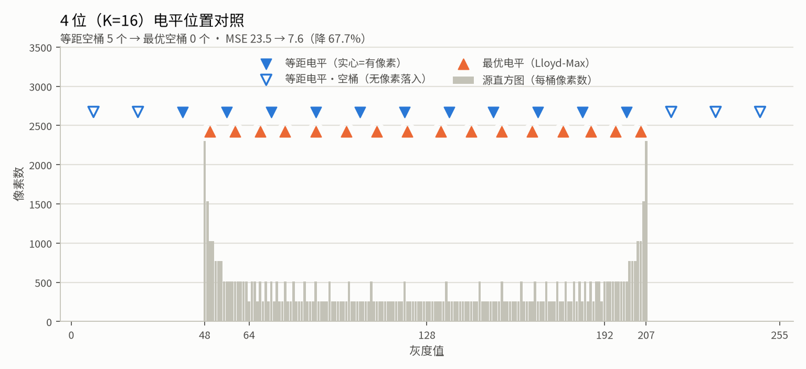
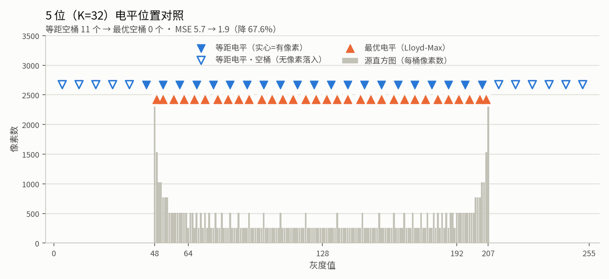
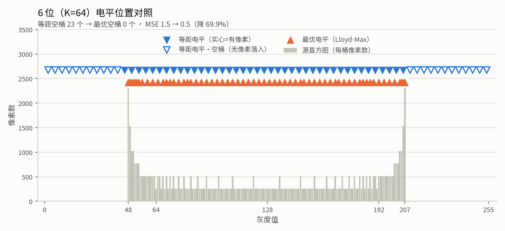

# 位深缩减的最优电平配置（Lloyd–Max 量化）

## 0. 现象与思路

8 位灰度图降到 5 位时，若只做等距截断（等距电平），输出直方图会出现
**空桶**——部分码字没有任何源像素落入；有效电平数少于 2^b，平滑渐变
断成几条可见的色带。根因：等距电平把 K 个码字均匀铺在 [0, 255] 上，
而源直方图是非均匀的（甚至有整段空区）：落在空区的电平被浪费，像素
密集区分到的电平又不够。电平总数不能变，能动的只有**电平的位置**。

本文把"重新摆电平"写成带约束的分配问题，给出最优性条件与证明，用
动态规划求全局最优解，并在 4/5/6 三档位深上与等距方案对照。

复现场景：256×256 水平渐变经 smoothstep 影调曲线压缩到 [48, 207]，
直方图两端重、中部稀，[48, 207] 之外全部为空桶（非空桶 160/256）。

## 1. 建模：带约束的分配问题

- 源直方图 h[v]，v ∈ {0, …, 255}；非空桶集合 S = {v : h[v] > 0}
- 决策变量：
  - K = 2^b 个电平 y₁ < y₂ < … < y_K（整数灰度，0–255）
  - 分配变量 x[v,k] ∈ {0,1}：桶 v 是否分给电平 k
- 约束：
  - **(A1) 电平数固定**：恰好 K 个电平
  - **(A2) 电平单调**：y₁ < y₂ < … < y_K
  - **(A3) 覆盖全部非空桶**：Σ_k x[v,k] = 1，∀v ∈ S
  - **(A4) 无空桶**：每个电平至少分到一个非空桶，Σ_{v∈S} x[v,k] ≥ 1，∀k
- 目标（最小化量化误差）：

  min D = Σ_v h[v] · Σ_k x[v,k]·(v − y_k)²

## 2. 最优性条件（Lloyd–Max）

**定理（必要条件）**。设 (x*, y*) 最优，则：

**(C1) 质心条件**——每个电平位于其 Voronoi 区间的条件期望处：

  y_k = E[v | v ∈ C_k] = (Σ_{v∈C_k} h[v]·v) / (Σ_{v∈C_k} h[v])

*证明*：固定划分，D 对 y_k 求导：∂D/∂y_k = −2 Σ_{v∈C_k} h[v](v − y_k)。
令其为零即得条件期望；二阶导 2·|C_k 的质量| > 0，故为最小。∎

**(C2) 最近邻条件**——区间边界两两相邻、无缝拼接：每个桶分给最近的
电平，相邻电平 y_k < y_{k+1} 的区间边界是二者中点

  b_k = (y_k + y_{k+1}) / 2

*证明*：若桶 v 分给 y_k 但存在 y_j 使 |v − y_j| < |v − y_k|，把 v 改分
给 y_j，D 严格下降 h[v]·((v − y_j)² − (v − y_k)²) < 0，与最优矛盾。
对 v 解 |v − y_k| = |v − y_{k+1}| 得边界为中点；相邻区间在中点处首尾
相接，铺满桶轴。∎

由 (C2)，最优划分是桶轴上的 **K 个连续段**——这是第 3 节 DP 能给出
全局最优的关键。

### 等距电平何时最优：只在源分布均匀时

**命题 1（源均匀 ⟹ 等距最优，且为全局最优）**。设 h[v] = c。宽 w 的
连续段的最优电平在段中心（C1），段代价

  g(w) = c · Σ_{i=0}^{w−1} (i − (w−1)/2)² = c·w(w² − 1)/12

只依赖宽度，且 g″(w) = c·w/2 > 0（严格凸）。总代价 Σ_k g(w_k) 在
Σ_k w_k = 256 下由 Jensen 不等式于 w_k 全相等时取最小；严格凸保证
唯一性。等宽划分 + 质心居中 ⟺ 电平等距。∎

**命题 2（等距最优 ⟹ 源均匀），两个严格版本**。

*版本 A（连续/高码率，Bennett–Panter–Dite）*：对密度 p(x)，K 电平
量化器的失真满足

  D ≥ (1/12K²) · (∫ p(x)^{1/3} dx)³

（对 D ≈ (1/12)∫ p/λ² dx 在 ∫λ = K 下用 Hölder 不等式），取等 ⟺
电平点密度 λ(x) ∝ p(x)^{1/3}。等距电平 ⟺ λ 为常数 ⟺ p^{1/3} 为常数
⟺ p 均匀。∎

*版本 B（离散，对所有二进细分同时成立）*：若等距电平对 K = 2, 4,
…, 256 全部满足 (C1)，则 h 必为常数。

*证明*：宽 2 区间 {2j, 2j+1} 质心居中 ⟺ h(2j) = h(2j+1)。归纳：设
h 在每个宽 2^{b−1} 块内为常数，则宽 2^b 区间质心居中 ⟹ 其左右两半
块的常数相等；递推至 b = 8 得 h 在 0–255 上全等。∎

*备注（单个 K 的一阶条件本身弱于"均匀"）*：只对单个 K 验证时，等距
满足 Lloyd 条件 ⟺ 每个等宽区间的质心恰好居中，这严格弱于源均匀
（反例：每个区间内部对称但形状任意的直方图）。但这类分布是测度为零
的退化情形，且通常不是全局最优；对真实源，等距方案离 Lloyd 不动点
很远——本实验中其质心残差达 2–8 个灰度级（见第 5 节表）。

## 3. 求解：一维动态规划（全局最优）

由 (C2) 最优划分是连续段，故只需在"把 256 个桶切成 K 段"中搜索：

  f[k][j] = min_{i<j}  f[k−1][i] + cost(i … j−1)

段代价 cost(i…j) 与最优电平用质量/一阶矩/二阶矩前缀和 O(1) 求得，
电平取段质心（条件期望）四舍五入到整数桶——灰度电平必须是整数。
复杂度 O(K·V²)，V = 256，秒级完成。DP 覆盖全部 256 个桶位置，空桶
自然并入相邻段，(A3) 自动满足；(A4) 由逐段质量检验保证。

## 4. 验证（脚本内置断言，全部通过）

- **(C1)** 最优解质心残差 ≤ 0.5 灰度级（仅整数舍入）
- **(C2)** 离散边界条件：任一相邻边界向任一侧移动一个桶，总代价
  不下降（连续情形 b_k = (y_k + y_{k+1})/2 的离散等价）
- **(A2)** 电平严格单调；**(A4)** 每段质量 > 0，空桶数 = 0
- 最优解 MSE 严格低于等距方案

## 5. 结果

| 位深 | K | 空桶(等距) | 空桶(最优) | MSE(等距) | MSE(最优) | ΔMSE(最优−等距) | 误差降幅 | 质心残差(等距) | 质心残差(最优) |
|---:|---:|---:|---:|---:|---:|---:|---:|---:|---:|
| 4 | 16 | 5 | **0** | 23.531 | **7.594** | −15.938 | 67.7% | 8.000 | 0.400 |
| 5 | 32 | 11 | **0** | 5.719 | **1.852** | −3.867 | 67.6% | 4.000 | 0.429 |
| 6 | 64 | 23 | **0** | 1.531 | **0.461** | −1.070 | 69.9% | 2.000 | 0.500 |

读法：

- 等距方案把电平均匀铺到 [0, 255]，落入源直方图空区的电平全部成为
  空桶，且 K 越大浪费越多（5 → 11 → 23 个）；这就是"直方图出现空格、
  渐变断带"的量化解释。
- 最优解把全部电平收进支撑集 [48, 207]，并在两端的高密度区加密、
  中部稀疏区放疏——正是 (C1)(C2) 要求的形状；空桶数严格为 0。
- 三档误差一致下降约 68–70%；等距方案的质心残差（2–8 级）说明它
  根本不满足 Lloyd 条件，而最优解的残差只剩整数舍入量（≤ 0.5）。

### 电平位置对照（每档一张）







图中灰柱为源直方图；蓝色倒三角为等距电平（空心 = 空桶，无像素落
入）；橙色正三角为 Lloyd–Max 最优电平。

## 复现

```
python3 analysis/lloyd_max.py
```

输出：`summary.csv`（上表数据）、`levels.csv`（三档两方案全部电平
位置与区间）、`levels_{4,5,6}bit.png`（对照图）。
